# Project File Reference

This file lists the main project files and what each one does, followed by a simple interaction flowchart. It has been refreshed to reflect the latest code polish, added inline comments, and minor adjustments made across the project.

---

## 1. Root-level files

- dashboard.py — Main launcher for the desktop dashboard interface.
- pyproject.toml — Python package metadata, dependencies, and project configuration.
- README.md — Main project documentation and usage instructions.
- PROJECT_EXPLANATION.md — Detailed explanation of the project architecture and design.
- PROJECT_101_GUIDE.md — Beginner-friendly walkthrough for recreating the project.
- requirements.txt — Python dependency list for quick setup.
- uv.lock — Reproducible dependency lockfile used with the current environment.
- run_agent.ps1 — PowerShell helper script for running the agent workflow.
- generate_html_reports.py — Helper script used to generate HTML debug reports.
- create_source_zip.py — Utility script that packages the project into a source ZIP archive.
- create_source_zip.ipynb — Notebook version of the source ZIP packaging helper.
- env_vars.txt — Example environment variable configuration.
- LICENSE — License information for the project.
- CONTRIBUTING.md — Contribution guidelines for future collaborators.
- Autonomous Code Debugging Agent.spec — Packaging specification for the desktop build.
- Autonomous_Code_Debugging_Agent_Install.zip — Installer/package artifact for distribution.
- professional_execution/ — Minimal runtime package for polished local deployment.
- Project_Autonomous_Code_Debugging_Agent.ipynb — Notebook prototype for experimentation and demos.
- Project_Autonomous_Code_Debugging_Agent.docx — Project documentation file in Word format.
- Project_Structure.docx — Structural overview document for the project.
- reports/ — Folder where HTML reports are stored after analysis.
- generated_repos/ — Sample/generated repositories used for testing and demos.
- build/ — Packaging/build output generated for the desktop/CLI distribution.
- dist/ — Final distribution artifacts produced during packaging.
- tests/ — Automated test suite for validation and regression checks.

---

## 2. Source files under src/autonomous_code_debugging_agent

### API layer
- src/autonomous_code_debugging_agent/api/main.py — CLI entry point to run analysis from the terminal.

### Core logic
- src/autonomous_code_debugging_agent/core.py — Central core module for shared project logic.
- src/autonomous_code_debugging_agent/core/config.py — Configuration loading and environment handling.
- src/autonomous_code_debugging_agent/core/logger.py — Logging utilities for debugging and tracing.

### GUI layer
- src/autonomous_code_debugging_agent/gui/dashboard.py — Tkinter-based desktop interface for the app.

### Ingestion layer
- src/autonomous_code_debugging_agent/ingestion/repo_loader.py — Loads repository files from local paths or external sources.
- src/autonomous_code_debugging_agent/ingestion/chunker.py — Splits repository code into smaller chunks for analysis.

### Embeddings and retrieval
- src/autonomous_code_debugging_agent/embeddings/embedder.py — Converts code/text into vector-like representations.
- src/autonomous_code_debugging_agent/embeddings/vector_store.py — Stores and searches embeddings in memory.
- src/autonomous_code_debugging_agent/retrieval/retriever.py — Finds the most relevant chunks for the given query.

### Reasoning layer
- src/autonomous_code_debugging_agent/reasoning/llm_interface.py — Talks to AI providers for debugging suggestions.
- src/autonomous_code_debugging_agent/reasoning/prompt_templates.py — Stores prompt formats for the AI model.

### Packaging and utility helpers
- create_source_zip.py — Builds a clean source archive for distribution.
- create_source_zip.ipynb — Notebook-based alternative for the same packaging step.

### Reporting layer
- src/autonomous_code_debugging_agent/reporting/html_reporter.py — Creates HTML reports from analysis output.

### Validation layer
- src/autonomous_code_debugging_agent/validation/dependency_check.py — Verifies that required dependencies are available.

### Workflow orchestration
- src/autonomous_code_debugging_agent/workflows/debugging_loop.py — Main workflow that ties ingestion, retrieval, reasoning, and reporting together.

### Agent layer
- src/autonomous_code_debugging_agent/agents/debugger_agent.py — Specialized agent logic for debugging behavior.

---

## 3. Recent polish and maintenance notes

- Inline comments were added across the main Python modules to improve code readability and explain the purpose of helper functions.
- Minor cleanups were applied to the notebook prototype and key workflow files after the comment pass.
- The project structure and documentation now match the current implementation more closely, including the packaging/build outputs, utility ZIP helpers, and the updated test suite.

---

## 4. Test files

- tests/test_dashboard.py — Verifies dashboard-related behavior.
- tests/test_pipeline.py — Verifies the main analysis pipeline.
- tests/test_reporting.py — Verifies report generation.
- tests/test_validation.py — Verifies validation and environment checks.

---

## 5. File interaction flowchart

For a larger, easier-to-read version, open [flowchart_fullscreen.html](flowchart_fullscreen.html) in a browser and use the Fullscreen button.

```mermaid
flowchart TD
    A[dashboard.py] --> B[src/autonomous_code_debugging_agent/gui/dashboard.py]
    B --> C[src/autonomous_code_debugging_agent/workflows/debugging_loop.py]
    C --> D[src/autonomous_code_debugging_agent/ingestion/repo_loader.py]
    C --> E[src/autonomous_code_debugging_agent/ingestion/chunker.py]
    C --> F[src/autonomous_code_debugging_agent/embeddings/embedder.py]
    C --> G[src/autonomous_code_debugging_agent/embeddings/vector_store.py]
    C --> H[src/autonomous_code_debugging_agent/retrieval/retriever.py]
    C --> I[src/autonomous_code_debugging_agent/reasoning/llm_interface.py]
    C --> J[src/autonomous_code_debugging_agent/reporting/html_reporter.py]
    I --> K[src/autonomous_code_debugging_agent/reasoning/prompt_templates.py]
    B --> L[src/autonomous_code_debugging_agent/api/main.py]
    M[generate_html_reports.py] --> J
    N[create_source_zip.py] --> O[Autonomous_Code_Debugging_Agent_Source.zip]
    P[create_source_zip.ipynb] --> O
    Q[Autonomous Code Debugging Agent.spec] --> R[build/]
    R --> S[dist/Autonomous Code Debugging Agent.exe]
    T[tests/test_pipeline.py] --> C
    U[tests/test_dashboard.py] --> B
    V[tests/test_reporting.py] --> J
    W[tests/test_validation.py] --> X[src/autonomous_code_debugging_agent/validation/dependency_check.py]
```

---

## 6. Quick summary

The project is organized as:
1. UI entry point
2. workflow orchestration
3. repository ingestion and chunking
4. embeddings and retrieval
5. AI reasoning and report generation
6. tests and validation
